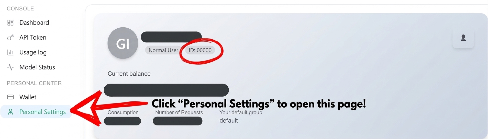
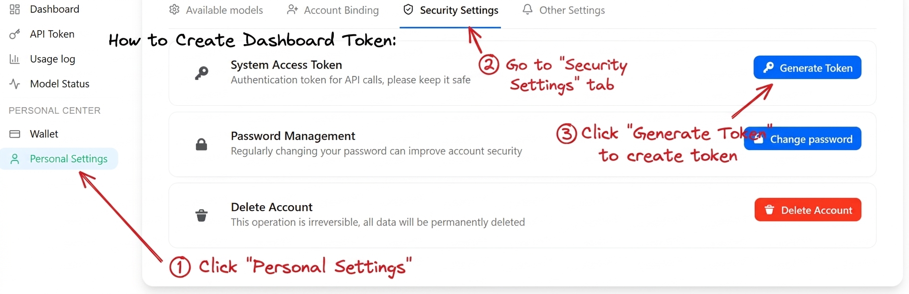

# AgentRouter Availability Prober

A Telegram bot that checks whether AgentRouter models respond and reports
availability changes, account usage, and API key quotas. By default it checks
every listed model every 15 minutes, with two requests at a time and up to
32 output tokens per probe.

## New to AgentRouter?

If you don’t have an AgentRouter account yet, you’re welcome to use my referral
link to get an extra **$50 in free credit** when you sign up.
[Sign up with my AgentRouter referral link](https://agentrouter.org/register?aff=Atwh)

- [Start with Docker](#start-with-docker)
- [Pair your Telegram account](#pair-your-telegram-account)
- [Set up AgentRouter credentials](#agentrouter-credentials)
- [Transfer ownership](#transfer-ownership-to-another-telegram-account)
- [Telegram commands](#telegram-commands)
- [Configuration](#configuration)

## Start with Docker

Use Docker Compose V2 on Windows or Linux. Run the commands from the
repository directory. Create a bot with `@BotFather`, copy `.env.example` to
`.env`, and set `TELEGRAM_BOT_TOKEN`. For a private bot, set a random
10-digit `OWNERSHIP_OTP` and leave `TELEGRAM_CHAT_ID` blank.
A verified numeric chat ID also satisfies the build requirement and skips
pairing. [Telegram bot setup](https://core.telegram.org/bots/features#botfather)

### Prepare the data directory

Compose bind-mounts `data/` at `/data`. Create the directory before starting.
On Windows, run `New-Item -ItemType Directory -Force data` in PowerShell.
On Linux with Docker Engine and no user ID remapping, prepare a **new** data
directory for the service's UID and GID, both `10001`.

```sh
sudo install -d -m 700 -o 10001 -g 10001 data
chmod 600 .env
```

For an existing installation, check write access before changing permissions.
The directory holds probe state, saved credentials, and Telegram registration.
Keep it when upgrading or recreating the container. Standalone containers use
UID and GID `999` by default. Run Compose with `sudo` if your Linux setup
requires it.

### Start the service

```sh
docker compose config --quiet
docker compose up -d --build prober
docker compose ps prober
```

Pair from a private Telegram chat, then tap **Status** to set up AgentRouter.
Alternatively, prefill AgentRouter credentials in `.env` before starting.
For a separate environment file, set `ENV_FILE` in your shell and pass the
same path to `docker compose --env-file` so the build and service use it.

### Upgrade an existing installation

Keep `.env` and `data/`, then run the same build and start commands. If you
still use `.env.vps`, copy its settings into `.env`. Installations with a
legacy `telegram.json` must pair again or set `TELEGRAM_CHAT_ID` explicitly.
Both API base URLs must use HTTPS.

Compose checks the project environment for `OWNERSHIP_OTP` or
`TELEGRAM_CHAT_ID` at build time. After pairing, you can leave the OTP set for
future builds or copy the verified chat ID from `data/ownership/.env` into
the project `.env` and clear the code.

## Registration

### Pair your Telegram account

1. With `TELEGRAM_CHAT_ID` blank, set `OWNERSHIP_OTP` in the project `.env` to
   a private, random 10-digit code you choose. Start the bot.
2. Send `/start` in a private chat, then reply with the code when prompted.
3. The bot replies **Connected. Choose an action to get started.** and saves the
   chat ID in `data/ownership/.env`. The saved owner survives restarts and
   rebuilds. For a custom `STATE_PATH`, look in `ownership/.env` beside it.

The pairing window lasts 10 minutes after the bot connects to Telegram. The
bot shows how many incorrect submissions remain. The limit defaults to 10
across all pairing chats and resets with `docker compose restart prober`.
Restart also opens a new pairing window with the configured code. To change
the limit, edit `OWNERSHIP_OTP_MAX_ATTEMPTS` and apply it with
`docker compose up -d --force-recreate prober`.

For a private bot, keep access owner-only. Pairing verifies the Telegram
account that replies. A manually entered ID grants access to whoever owns
that chat, so double-check it if you skip pairing. Disable group joins with
`/setjoingroups` in `@BotFather` if the bot is only for private use. The bot
enforces owner-only commands and account information in private chat.
[Telegram bot settings](https://core.telegram.org/bots/features#edit-settings)

Registration is tied to the bot's numeric ID, so token rotation keeps the
saved owner. Use a fresh OTP when switching to a different bot. Run one
Telegram update listener per bot and remove any webhook before using polling.

### Transfer ownership to another Telegram account

The new owner gains access to the AgentRouter account configured on the bot.

1. Stop the service with `docker compose stop prober`.
2. If `data/ownership/.env` exists, clear only its `TELEGRAM_CHAT_ID` value.
   On Linux you may need elevated permission to edit the file.
3. In the project `.env`, clear `TELEGRAM_CHAT_ID` and set a fresh
   `OWNERSHIP_OTP`. If you have the new owner's verified numeric chat ID, you
   can enter it in the project `.env` and clear the OTP. A chat ID in the project
   `.env` takes precedence over the saved registration.
4. Run `docker compose up -d --build --force-recreate prober` to load the new
   settings.
5. If using an OTP, send `/start` from the **new account** and reply with the
   code. The bot saves the new chat ID.

## AgentRouter credentials

The model API key authorizes probes. The dashboard token and matching account ID
authorize reads for model discovery, balance, quotas, and usage logs.

### Find your account ID

In the AgentRouter console, open **Personal Settings** and copy the number next
to **ID** on your profile card. [AgentRouter console](https://agentrouter.org/console)



### Generate a dashboard token

In **Personal Settings → Security Settings**, select **Generate Token** under
**System Access Token**. Copy the raw token.
[AgentRouter console](https://agentrouter.org/console)



### Enter credentials in Telegram

In the registered private chat, tap **Status**, **Balance**, or another
AgentRouter feature. The bot requests any missing values in this order:
model API key, account ID, dashboard token. Send the values as text. The bot
tries to delete credential messages and tells you if you need to delete one
manually. Rotate the credential if it may have been exposed.

### Prefill credentials in `.env`

You can supply some or all credentials in the project `.env`. A group or
channel destination requires prefilled or saved credentials.

```dotenv
AGENTROUTER_API_KEY=sk-your-model-key
AGENTROUTER_USER_ID=12345
AGENTROUTER_DASHBOARD_TOKEN=your-dashboard-access-token
```

### Validation and storage

The bot validates the model key with `/v1/models` and the dashboard pair with
`/api/user/self`. Temporary failures retry automatically during startup and
interactive setup. If a credential is rejected, the bot prompts the private
owner for the affected value or dashboard pair.

Monitoring starts after validation and saving. The bot saves verified credentials
to `data/credentials/.env` in Compose, or `credentials/.env` beside
`STATE_PATH` when running directly. Saved values take precedence over the
project `.env` and are rechecked at startup. To rotate a saved credential, edit
the saved file and run `docker compose up -d --force-recreate prober`. For
details on startup errors, see [Troubleshooting](#troubleshooting).

## Telegram commands

Commands are available to the owner in a private chat. An explicitly
configured group or channel can receive automatic availability and probing-key
alerts. Send `/start` to refresh the keyboard or `/help` for a command list.

| Button | Command | What it does |
| --- | --- | --- |
| **Status** | `/status` | Shows the latest probe results. Waits for a sweep in progress and starts one if no results exist. |
| **Probe Now** | `/probe_now` | Starts or joins a sweep. New manual sweeps have a 60-second cooldown after completion. |
| **Balance** | `/balance` | Shows wallet balance, total spend, request count, and group. |
| **Schedule** | `/probing_schedule` | Sets the next automatic interval to 5, 15, or 30 minutes, or restores `POLL_SECONDS`. The choice persists. |
| **Credit Alerts** | `/credit_alerts` | Sets one-time alerts for account spending and low balance. |
| **API Keys** | `/api_keys` | Shows quotas, lifetime spend, usage history, key alerts, and restrictions. |
| **Weekly Digest** | `/weekly_digest` | Shows the last two completed UTC weeks and lets you enable automatic delivery. |

**Probe Now** labels previous results and shows the last successful check time
when discovery fails. If a restart interrupts a manual sweep, the bot reports
that the outcome is unknown. Tap **Probe Now** to request another sweep.
The command aliases `/probe`, `/usage`, and `/schedule` remain available.

## Credit alerts

Set one **Spending Alert** and one **Low Balance Alert** from the **Credit
Alerts** menu. Use the units shown by **Balance**. Dollar amounts accept two
decimal places. Quota amounts use whole numbers. Spending alerts add the
entered amount to total spend at setup. Balance alerts fire below the entered
threshold. Alerts persist across restarts and clear after Telegram accepts them.

The bot also warns when the key used for probes falls below `$1.00` by
default. The warning rearms after quota recovers. Set
`PROBE_KEY_LOW_BALANCE_USD` to change the threshold. If the dashboard hides
the full key, set `AGENTROUTER_PROBE_KEY_ID` to the numeric ID shown in
**API Keys**. An exact match takes precedence when AgentRouter returns the
full key. Unlimited keys have no per-key balance to monitor.

## API key monitoring

**API Keys** shows shared balance and each key's quota, lifetime spend, and
status. The bar shows the share spent, followed by `[spent/left]`. Unlimited
keys display `∞`. Select a key to see its details.

- **Last 24 Hours** and **Last 7 Days** show logged requests, spend, and top
  models by spend.
- **Key Alerts** sets one-time spending, low-quota, and expiry alerts.
  **Clear Alerts** clears the selected key's custom alerts.
- **Troubleshoot Key** shows status, group, model and IP restrictions, and the
  latest results from the bot's probing key.

**Weekly Digest** compares logged spend with the prior UTC week and shows the
top five keys and models. Auto-send is off by default. Once enabled, the bot
checks for a completed week at each scheduled cycle. Alert and digest settings
persist across restarts.

## Availability behavior

The bot discovers models from `/api/user/model-status` and probes each listed
model, including those marked degraded or down. It uses the advertised APIs
in this order: Responses, Chat Completions, Anthropic Messages. Responses
cut short by the output-token limit still confirm availability if AgentRouter
reports generated output.

Confirmed responses are **Available**. Recognized pool-exhaustion,
no-channel, and model-not-found responses are **Unavailable**. Temporary
errors, including generic HTTP 503 responses, appear as **Unknown** while
the previously confirmed availability is retained. The bot sends a grouped
list when confirmed availability changes. Pending alerts and Telegram
rate-limit delays persist across restarts.

## Configuration

| Variable | Default | Purpose |
| --- | --- | --- |
| `TELEGRAM_BOT_TOKEN` | Required | Bot token from `@BotFather` |
| `TELEGRAM_CHAT_ID` | Empty | Numeric chat ID or channel `@username`. Leave blank to pair. |
| `OWNERSHIP_OTP` | Empty | Private 10-digit code for pairing |
| `OWNERSHIP_OTP_MAX_ATTEMPTS` | `10` | Incorrect pairing submissions allowed before restart |
| `TELEGRAM_API_BASE_URL` | `https://api.telegram.org` | Telegram API endpoint |
| `AGENTROUTER_BASE_URL` | `https://agentrouter.org` | AgentRouter API endpoint |
| `AGENTROUTER_API_KEY` | Empty | Model key for probes |
| `AGENTROUTER_USER_ID` | Empty | Positive numeric dashboard account ID |
| `AGENTROUTER_DASHBOARD_TOKEN` | Empty | Dashboard system access token |
| `AGENTROUTER_PROBE_KEY_ID` | Empty | Numeric ID used when the dashboard masks the probe key |
| `POLL_SECONDS` | `900` | Default time between automatic sweeps |
| `PROBE_MAX_OUTPUT_TOKENS` | `32` | Output-token limit per probe |
| `PROBE_REASONING_EFFORT` | `low` | Responses effort. Accepts `minimal`, `low`, `medium`, or `high`. |
| `PROBE_CONCURRENCY` | `2` | Maximum simultaneous model probes |
| `PROBE_KEY_LOW_BALANCE_USD` | `1.00` | Probe key's low-quota threshold in USD |
| `REQUEST_TIMEOUT_SECONDS` | `90` | HTTP request timeout |
| `STATE_PATH` | `/data/state.json` | State file. Compose sets this path in the container. |
| `HEALTH_MAX_AGE_SECONDS` | `3600` | Maximum age of a successful model-status read |
| `AGENTROUTER_CLIENT_USER_AGENT` | `codex_cli_rs/0.171.0 (Windows 11; x86_64)` | AgentRouter user agent. Requests also send `originator: codex_cli_rs`. |
| `LOG_LEVEL` | `INFO` | Logging level |

Custom API URLs may include an HTTPS path prefix. Omit embedded credentials,
query strings, and fragments. Legacy environment aliases
`CODEX_GATEWAY_API_KEY`, `NORMAL_POLL_SECONDS`, and
`CONFIRM_MAX_OUTPUT_TOKENS` are fallbacks for the model key, polling interval,
and output-token limit respectively.

## Troubleshooting

Run `docker compose ps prober` and `docker compose logs --tail=80 prober`.
Docker health validates local Telegram ownership and configuration. Once the
three AgentRouter credentials are present, it also checks the age of the last
successful model-status read. A fresh model-status read clears a health
failure caused by stale results. For the last recorded Telegram contact, run
`docker compose exec prober python -m agentrouter_prober --telegram-status`.

| Symptom | Action |
| --- | --- |
| Bind source path does not exist | Create `data/` beside `compose.yaml`. |
| Permission error opening or saving state | Check the bind mount's write access for the service UID and GID. |
| Invalid ownership settings | Check the project chat ID or pairing code. If the saved registration is corrupt, follow the ownership transfer procedure. |
| AgentRouter rejected dashboard authentication | Verify that the numeric account ID and raw dashboard token belong together. |
| AgentRouter returns browser verification | Check API access from the Docker host. |
| AgentRouter reports no upstream channel for model status | Check the AgentRouter model-status page. The bot retries discovery on its normal schedule. |
| Telegram polling conflict | Stop the other listener or remove the webhook for this bot. |
| State file is already in use | Stop the daemon before running `--once` against the same state file. |

For a Telegram-only delivery check, use
`docker compose run --rm prober --test-telegram`. If the bot still needs to
pair, stop the daemon first so only one process polls Telegram.

To run a single live cycle, stop the service first. This uses AgentRouter quota
and can send Telegram alerts.

```sh
docker compose stop prober
docker compose run --rm prober --once
docker compose start prober
```

The daemon and `--once` lock the state file for writing via a neighboring
lock file. The OS releases the lock at process exit, and the lock file stays
on disk. Unreadable probe state is preserved beside `STATE_PATH` with a
`.corrupt-` suffix when monitoring starts.

## Run directly on Windows

Use Python 3.11 or newer. Set configuration in your shell before starting.

```powershell
python -m pip install -e .
$env:TELEGRAM_BOT_TOKEN = Read-Host "Telegram bot token"
$env:OWNERSHIP_OTP = Read-Host "Random 10-digit ownership code"
$env:STATE_PATH = "$PWD\data\state.json"
python -m agentrouter_prober
```

## Tests

```sh
python -m pip install -e ".[test]"
python -m pytest tests/
```

The tests run offline with mock HTTP transports.

## Update Docker image and dependency pins

Review the pins monthly and sooner for security updates. Get the
multi-platform digest with
`docker buildx imagetools inspect docker.io/library/python:3.13-slim` and
update `Dockerfile`. In a Python 3.13 environment with `pip-tools` and the test
dependencies installed, refresh the hashed requirements and verify the build.

```sh
python -m piptools compile --upgrade --all-build-deps --allow-unsafe \
  --generate-hashes --strip-extras --no-emit-index-url \
  --pip-args='--only-binary=:all:' --output-file requirements-docker.txt pyproject.toml
python -m pip install --require-hashes --only-binary=:all: -r requirements-docker.txt
python -m pip install --no-deps --no-build-isolation -e .
python -m pytest tests/
docker compose build
```

Commit the digest and requirements together after tests and the build pass.
